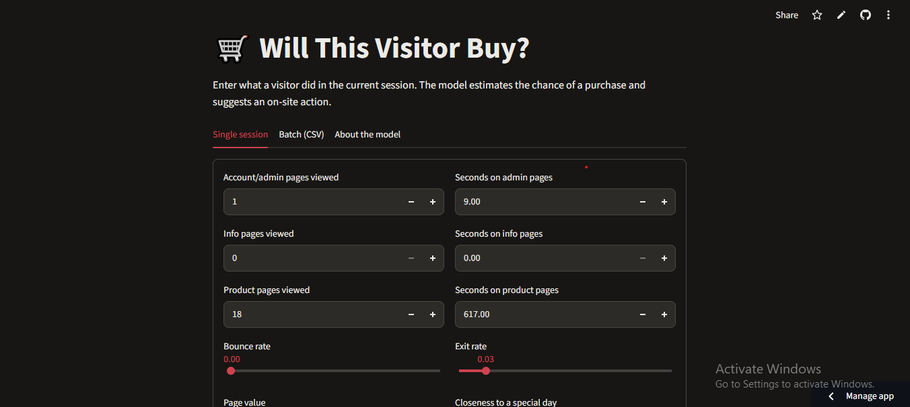

# 🛒 Will This Visitor Buy? Real-Time Purchase Intent

Most online-store visitors leave without buying. This project predicts from a browsing session whether the visitor will purchase, and recommends an on-site action (**no action / show coupon / show chat assistant**) so discounts go only where they matter.

**🔗 Live app:** `PASTE_STREAMLIT_LINK_HERE`



## Results

Data: 12,205 real shopping sessions (after removing 125 duplicates), 15.6% end in a purchase. Test set = 20% of sessions (2,441), untouched until the final evaluation.

| Model | CV ROC-AUC | Test ROC-AUC | Test PR-AUC | Recall@0.5 | F1@0.5 |
|---|---|---|---|---|---|
| Baseline (majority class) | - | 0.500 | 0.156 | 0.000 | 0.000 |
| Logistic Regression | 0.918 | 0.928 | 0.696 | 0.830 | 0.663 |
| Random Forest | 0.931 | 0.932 | 0.741 | 0.775 | 0.677 |
| **Gradient Boosting (selected)** | **0.933** | **0.937** | **0.759** | 0.613 | 0.658 |

The model was selected by cross-validation score, not by test score.

**At the tuned threshold (0.36):** precision 0.663, recall 0.720, F1 0.690. On the test set it catches 275 of 382 real buyers, with 140 false alarms.

**Targeting efficiency:** the top 10% of sessions by score contain 51% of all buyers (purchase rate 79.6% in that group vs 15.6% overall).

### Key findings
- `PageValues` is by far the most important feature (permutation importance), followed by `Month` and `ExitRates`.
- New visitors convert at 24.9% vs 14.1% for returning visitors.
- November converts best (25.5%); February is the weakest (1.7%).
- The model mostly misses buyers whose sessions have `PageValues = 0` (it misses 95.8% of those buyers, vs 12.3% of buyers with `PageValues > 0`).

## Approach
1. **Problem framing:** target `Revenue`; accuracy is misleading on imbalanced data (always predicting "no buy" is 84.4% accurate), so ROC-AUC, PR-AUC and recall/precision are used.
2. **EDA:** univariate, bivariate (conversion by visitor type, month, PageValues) and multivariate (correlations).
3. **Pipeline (no leakage):** split first; imputation, scaling and one-hot encoding inside a scikit-learn `Pipeline`; row-wise feature engineering in `features.py`.
4. **Modeling:** majority-class baseline + Logistic Regression, Random Forest, Gradient Boosting; `RandomizedSearchCV` with stratified 5-fold CV on the training set only.
5. **Threshold policy:** two thresholds derived from out-of-fold training predictions: chat at 0.36 (F1-optimal), coupon from 0.095 (recall ≥ 90%).
6. **Error analysis + permutation importance + lift table.**

## Limitations
- One store, about one year of data.
- `PageValues` is computed from pages visited before a transaction; for real-time use it must be computed from the partial session only, so live performance may be lower.
- Probabilities are not causal uplift: an A/B test is needed to prove coupon impact.

## Run it
```bash
pip install -r requirements.txt
# 1. Download online_shoppers_intention.csv from the dataset link below into this folder
# 2. Run purchase_intent_v2.ipynb top to bottom (creates model.joblib)
streamlit run app.py
```
The model was trained with scikit-learn 1.6.1, so `requirements.txt` pins that version.

## Files
- `purchase_intent_v2.ipynb`: full analysis and model training
- `features.py`: feature engineering shared by notebook and app
- `app.py`: Streamlit app (single session + batch CSV)
- `model.joblib`: saved pipeline + thresholds

## Data
Online Shoppers Purchasing Intention Dataset, UCI Machine Learning Repository: https://archive.ics.uci.edu/dataset/468 (not included in this repo).
